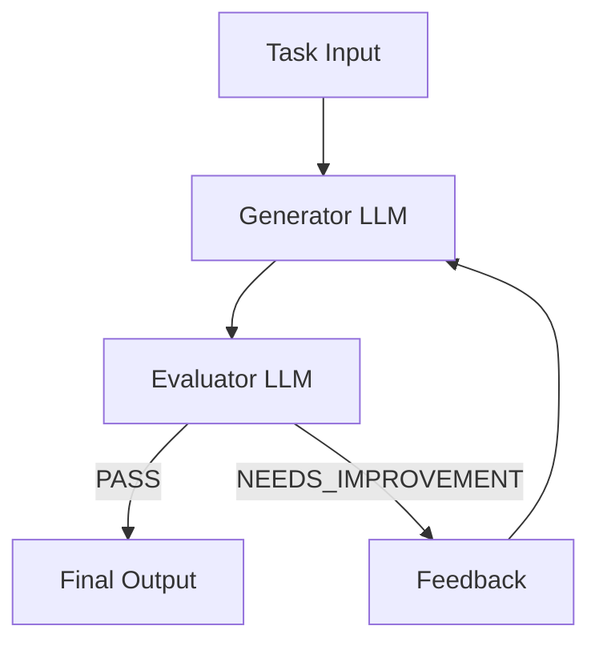

# 评估器—优化器模式

本项目演示用于构建高效 LLM 系统的评估器—优化器模式，参考 [Anthropic 关于构建高效智能体的研究](https://www.anthropic.com/research/building-effective-agents)。


## 概述

评估器—优化器模式实现了一个双 LLM 流程：一个模型生成响应，另一个模型在迭代循环中提供评估和反馈，类似于人类作者的精炼过程。该模式包含两个主要组件：

- **生成器 LLM**：生成初始响应，并根据反馈对其进行精炼
- **评估器 LLM**：分析响应并提供详细的改进反馈

## 工作原理

1. 生成器 LLM 为给定任务生成初始解决方案
2. 评估器 LLM 依据质量标准评估该解决方案
3. 如果解决方案通过评估，则作为最终结果返回
4. 如果需要改进，则将反馈纳入新的生成循环
5. 重复该过程，直到获得令人满意的解决方案



## 使用场景

该模式在以下情况下特别有效：

- 存在用于评估响应质量的明确评估标准
- 迭代精炼能为输出带来可衡量的价值
- 任务受益于多轮评审与改进

### 示例应用

- 需要捕捉细微差别的文学翻译
- 需要多轮搜索与分析的复杂搜索任务
- 可通过系统性审查提升质量的代码生成
- 需要多份草稿与针对性改进的内容创作

## 实现

本实现使用 Spring AI 的 ChatClient 进行 LLM 交互，包含：

```java
public class EvaluatorOptimizer {
    public RefinedResponse loop(String task) {
        // 1. Generate initial solution
        Generation generation = generate(task, context);
        
        // 2. Evaluate the solution
        EvaluationResponse evaluation = evaluate(generation.response(), task);
        
        // 3. If PASS, return solution
        // 4. If NEEDS_IMPROVEMENT, incorporate feedback and generate new solution
        // 5. Repeat until satisfactory
        return new RefinedResponse(finalSolution, chainOfThought);
    }
}
```

### 用法示例

```java
ChatClient chatClient = // ... initialize chat client
EvaluatorOptimizer agent = new EvaluatorOptimizer(chatClient);

// Process a task
RefinedResponse response = agent.loop(
    "Create a Java class implementing a thread-safe counter"
);

// Access results
System.out.println("Final Solution: " + response.solution());
System.out.println("Evolution: " + response.chainOfThought());
```

## 自定义

该模式可以通过以下方式进行自定义：

1. **自定义提示词**：为生成器和评估器提供专门的提示词
```java
agent = new EvaluatorOptimizer(
    chatClient,
    customGeneratorPrompt,
    customEvaluatorPrompt
);
```

2. **默认模板**：为常见用例修改默认提示词
   - `DEFAULT_GENERATOR_PROMPT`：用于生成解决方案的模板
   - `DEFAULT_EVALUATOR_PROMPT`：用于评估解决方案的模板

## 响应格式

### 生成响应
```json
{
    "thoughts": "Brief description of approach",
    "response": "Actual solution content"
}
```

### 评估响应
```json
{
    "evaluation": "PASS|NEEDS_IMPROVEMENT|FAIL",
    "feedback": "Detailed feedback for improvement"
}
```

## 依赖

- Spring AI
- Spring Boot
- Java 17 或更高版本

## 参考资料

- [Building Effective Agents（Anthropic 研究）](https://www.anthropic.com/research/building-effective-agents)
