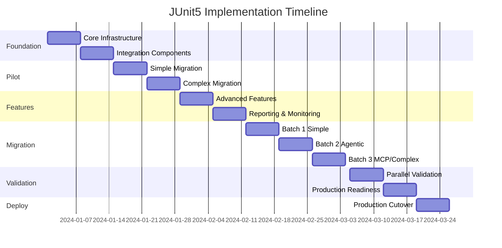

# JUnit5 实施路线图

## 执行摘要

本路线图规划了将 Spring AI Examples 集成测试框架从基于 JBang 的脚本改造为带 AI 校验的现代化 JUnit5 注解驱动系统的实施方案。实施周期为 12 周，包含清晰的里程碑、交付物与成功标准。

## 愿景与目标

### 愿景陈述
打造世界一流的集成测试框架，借助 AI 校验复杂的非确定性输出，同时为开发者提供熟悉的 JUnit5 工具链与出色的 IDE 支持。

### 战略目标
1. **开发者体验**：通过 IDE 集成将测试调试时间减少 40%
2. **可靠性**：借助智能校验实现 99% 的测试可靠性
3. **性能**：保持或改善当前的测试执行耗时
4. **成本效率**：通过缓存与批处理优化 AI 校验成本
5. **可维护性**：将测试维护工作量减少 50%

## 实施阶段

### 阶段 0：规划与准备（第 0 周 —— 实施前）
**状态**：✅ 已完成

#### 已完成的交付物
- ✅ 架构设计文档
- ✅ 迁移策略文档
- ✅ AI 校验器集成设计
- ✅ API 设计规范
- ✅ 实施路线图（本文档）

### 阶段 1：基础开发（第 1-2 周）

#### 第 1 周：核心基础设施
**目标**：建立 JUnit5 扩展框架的基础

**任务**：
- [ ] 创建 Maven 模块：`spring-ai-test-framework`
- [ ] 实现核心注解
  - [ ] `@SpringAIIntegrationTest`
  - [ ] `@AIValidation`
  - [ ] `@ExpectedBehavior`，支持从 README 推断
  - [ ] `@SuccessPatterns`
  - [ ] `@ContextResources`，用于多来源上下文
- [ ] 开发 `SpringAITestExtension` 骨架
- [ ] 搭建项目结构与依赖

**交付物**：
- 可编译的框架模块
- 基础注解处理器
- 注解的单元测试

**成功标准**：
- 框架编译无错误
- 注解可应用于测试类
- 扩展能在 JUnit5 运行时中加载

#### 第 2 周：集成组件
**目标**：构建校验引擎的集成

**任务**：
- [ ] 实现 `AIValidationController`
- [ ] 创建 `ProcessBasedValidatorExecutor`
- [ ] 开发带 README 推断能力的 `ValidationRequestBuilder`
- [ ] 构建 `ValidationResponseParser`
- [ ] 创建用于 README 解析的 `ContextInferenceEngine`
- [ ] 实现用于 Markdown 处理的 `ReadmeParser`
- [ ] 为 `IntegrationTestUtils` 创建兼容桥接层

**交付物**：
- 可运行的校验流水线
- JSON 转注解的转换工具
- 校验流程的集成测试

**成功标准**：
- 可从 Java 调用 Python 校验器
- 往返校验测试成功
- 转换器可生成合法的 Java 代码

### 阶段 2：试点实施（第 3-4 周）

#### 第 3 周：简单示例迁移
**目标**：迁移并验证简单示例

**目标模块**：`kotlin/kotlin-hello-world`

**任务**：
- [ ] 将 `ExampleInfo.json` 转换为注解
- [ ] 创建 `KotlinHelloWorldIntegrationTest.java`
- [ ] 实现输出捕获机制
- [ ] 添加正则模式校验
- [ ] 集成 AI 校验

**交付物**：
- 首个可运行的 JUnit5 集成测试
- 并排对比报告
- 性能基准

**成功标准**：
- 测试可通过 JUnit5 运行
- 结果与 JBang 执行一致
- 性能与原始实现相差不超过 10%

#### 第 4 周：复杂示例迁移
**目标**：验证复杂工作流的处理

**目标模块**：
1. `agentic-patterns/chain-workflow`（复杂工作流）
2. `model-context-protocol/sqlite/simple`（MCP 协议）

**任务**：
- [ ] 迁移 chain-workflow 示例
- [ ] 实现 setup/teardown 命令支持
- [ ] 迁移 MCP 示例
- [ ] 添加组件校验支持
- [ ] 创建对比测试套件

**交付物**：
- 两个复杂迁移完成
- 校验对比报告
- 边界情况文档

**成功标准**：
- 两个测试都能稳定通过
- AI 校验给出准确结果
- setup/teardown 命令正确执行

### 阶段 3：功能开发（第 5-6 周）

#### 第 5 周：高级功能
**目标**：实现性能与成本优化

**任务**：
- [ ] 实现校验缓存系统
- [ ] 添加批量校验支持
- [ ] 创建成本跟踪模块
- [ ] 开发并行执行支持
- [ ] 构建重试机制

**交付物**：
- 基于 Caffeine 的缓存层
- 成本跟踪看板
- 并行执行配置

**成功标准**：
- 测试中缓存命中率达到 50%
- 成本跟踪误差在 5% 以内
- 并行执行将耗时缩短 30%

#### 第 6 周：报告与监控
**目标**：构建完整的报告体系

**任务**：
- [ ] 创建 HTML 报告生成器
- [ ] 实现指标采集（Micrometer）
- [ ] 添加日志切面
- [ ] 构建测试趋势分析器
- [ ] 创建 CI/CD 集成适配器

**交付物**：
- 丰富的 HTML 测试报告
- Grafana 看板配置
- Jenkins/GitHub Actions 的 CI/CD 插件

**成功标准**：
- 报告可自动生成
- 指标可在监控系统中查看
- CI/CD 集成可用

### 阶段 4：批量迁移（第 7-9 周）

#### 第 7 周：批次 1 —— 简单示例
**目标**：迁移所有简单示例

**目标模块**（8 个模块）：
- `kotlin/kotlin-function-callback`
- `models/chat/helloworld`
- `misc/openai-streaming-response`
- `misc/multi-modality-chat-oai`
- `misc/function-callback`
- `prompt-engineering/prompt-advance-techniques`
- `prompt-engineering/prompt-to-object`

**自动化**：
```bash
./scripts/batch-migrate.sh --batch simple
```

**成功标准**：
- 全部 8 个模块迁移完成
- 测试通过率 100%
- 自动化迁移工具可正常工作

#### 第 8 周：批次 2 —— 智能体模式
**目标**：迁移智能体模式示例

**目标模块**（5 个模块）：
- `agentic-patterns/orchestrator-workers`
- `agentic-patterns/parallelization`
- `agentic-patterns/routing`
- `agentic-patterns/evaluator-optimizer`

**成功标准**：
- 复杂工作流校验正确
- AI 校验置信度 > 0.85
- 性能无下降

#### 第 9 周：批次 3 —— MCP 与复杂示例
**目标**：完成剩余迁移

**目标模块**（11 个模块）：
- 所有剩余 MCP 示例
- `agents/reflection`
- `rag/query-based-rag`
- 其他复杂示例

**成功标准**：
- 全部 24 个模块迁移完成
- 回归测试套件通过
- 文档已更新

### 阶段 5：验证与优化（第 10-11 周）

#### 第 10 周：并行验证
**目标**：并行运行两套系统

**任务**：
- [ ] 搭建双执行流水线
- [ ] 创建对比看板
- [ ] 运行完整回归套件
- [ ] 分析差异
- [ ] 性能优化

**交付物**：
- 对比报告
- 性能分析
- 优化建议

**成功标准**：
- 差异率低于 1%
- 性能达到目标
- 未发现关键问题

#### 第 11 周：生产就绪
**目标**：为生产切换做好准备

**任务**：
- [ ] 最终缺陷修复
- [ ] 更新文档
- [ ] 制作培训材料
- [ ] 测试回滚流程
- [ ] 干系人签署确认

**交付物**：
- 生产部署计划
- 培训文档
- 视频教程
- 回滚脚本

**成功标准**：
- 所有干系人认可
- 培训完成
- 回滚测试成功

### 阶段 6：部署与过渡（第 12 周）

#### 第 12 周：生产切换
**目标**：切换为以 JUnit5 为主系统

**任务**：
- [ ] 更新 CI/CD 流水线
- [ ] 部署到生产环境
- [ ] 监控问题
- [ ] 归档 JBang 脚本
- [ ] 实施后复盘

**交付物**：
- 更新后的 CI/CD 配置
- 已归档的旧系统
- 经验教训文档
- 成功指标报告

**成功标准**：
- 生产环境零事故
- 所有测试通过
- 开发者反馈积极

## 详细时间表



## 资源分配

### 团队结构

#### 核心团队
- **技术负责人**（投入 100%）
  - 架构决策
  - 代码评审
  - 干系人沟通

- **高级开发工程师**（投入 100%）
  - 框架开发
  - 复杂迁移
  - 性能优化

- **开发工程师**（投入 75%）
  - 模块迁移
  - 测试与验证
  - 文档编写

- **QA 工程师**（投入 50%）
  - 测试验证
  - 回归测试
  - 质量指标

- **DevOps 工程师**（投入 25%）
  - CI/CD 更新
  - 基础设施搭建
  - 监控配置

### 工作量估算

| 阶段 | 人日 | 关键资源 |
|-------|------------|---------------|
| 基础开发 | 20 | 技术负责人、高级开发 |
| 试点 | 15 | 高级开发、开发工程师 |
| 功能开发 | 20 | 高级开发、开发工程师 |
| 批量迁移 | 30 | 开发工程师、QA |
| 验证 | 15 | QA、DevOps |
| 部署 | 10 | DevOps、技术负责人 |
| **合计** | **110** | |

## 风险管理

### 风险矩阵

| 风险 | 概率 | 影响 | 缓解措施 |
|------|------------|--------|------------|
| AI 校验结果存在差异 | 中 | 高 | 大量对比测试 |
| 性能下降 | 低 | 高 | 持续基准测试 |
| 迁移工具故障 | 中 | 中 | 手工兜底流程 |
| 开发者抵触 | 低 | 中 | 培训与文档 |
| 成本超支 | 低 | 低 | 预算监控 |
| 进度延迟 | 中 | 中 | 预留缓冲时间 |

### 应急方案

#### 方案 A：完整迁移
- 完成全部 24 个模块
- 功能完全对等
- 能力增强

#### 方案 B：混合方式
- 复杂示例继续留在 JBang
- 迁移简单/中等复杂度的示例
- 用 6 个月逐步过渡

#### 方案 C：最小迁移
- 框架用于新测试
- 现有测试保留在 JBang
- 提供可选的迁移路径

## 成功指标

### 技术指标

| 指标 | 当前 | 目标 | 测量方式 |
|--------|---------|--------|-------------|
| 测试执行耗时 | 15 分钟 | 12 分钟 | CI/CD 流水线 |
| 测试可靠性 | 95% | 99% | 30 天内的通过率 |
| 调试耗时 | 平均 30 分钟 | 平均 18 分钟 | 开发者问卷 |
| 代码覆盖率 | 75% | 85% | 覆盖率工具 |
| AI 校验准确率 | 90% | 95% | 对比分析 |

### 业务指标

| 指标 | 目标 | 测量方式 |
|--------|--------|-------------|
| 开发者满意度 | 4.5/5 | 问卷 |
| 每月维护工时 | -40% | 时间跟踪 |
| 测试创建耗时 | -30% | 故事点 |
| 生产事故 | -25% | 事故报告 |

### 成本指标

| 指标 | 预算 | 跟踪方式 |
|--------|--------|----------|
| 开发成本 | $150,000 | 时间跟踪 |
| 每月 AI 校验成本 | $500 | API 用量 |
| 基础设施成本 | $1,000 | 云服务账单 |
| 培训成本 | $5,000 | 培训预算 |

## 干系人沟通

### 沟通计划

#### 每周更新
- 里程碑进展
- 阻塞项与风险
- 指标看板

#### 双周演示
- 已完成的功能
- 迁移进展
- 性能对比

#### 月度评审
- 执行摘要
- 预算状况
- 风险评估

### 干系人矩阵

| 干系人 | 关注度 | 影响力 | 沟通方式 |
|-------------|----------|-----------|---------------|
| 开发团队 | 高 | 高 | 每日站会 |
| 工程经理 | 高 | 高 | 每周一对一 |
| 产品负责人 | 中 | 高 | 双周演示 |
| QA 团队 | 高 | 中 | 每周同步 |
| DevOps 团队 | 中 | 中 | 按需 |
| CTO | 低 | 高 | 月度报告 |

## 培训计划

### 开发者培训

#### 第 10 周：入门工作坊（2 小时）
- JUnit5 基础
- 注解系统
- IDE 集成

#### 第 11 周：进阶工作坊（4 小时）
- AI 校验配置
- 成本优化
- 故障排查

#### 第 12 周：动手实验（4 小时）
- 共同迁移一个测试
- 调试常见问题
- 最佳实践

### 文档

#### 用户指南
- 快速上手
- 注解参考
- 配置指南
- 故障排查

#### 迁移指南
- 分步操作说明
- 转换工具用法
- 常见模式

#### API 文档
- 所有公共 API 的 JavaDoc
- 架构图
- 扩展点

## 实施后

### 第 13-14 周：稳定期
- 监控生产使用情况
- 处理反馈
- 性能调优
- 缺陷修复

### 第 15-16 周：增强规划
- 收集功能需求
- 规划第二阶段的特性
- 更新路线图

### 第 2-3 个月：持续改进
- 实施小幅增强
- 依据使用模式进行优化
- 扩充文档

## 未来路线图（12 周之后）

### 第二季度：增强功能
- 多模型 AI 支持（GPT-4、Gemini）
- 高级模板系统
- 智能测试生成

### 第三季度：平台功能
- 测试结果分析
- 预测性失败分析
- 自愈测试

### 第四季度：企业级功能
- 多租户支持
- 基于角色的访问控制
- 审计日志

## 预算摘要

### 开发成本
- 人力：$120,000（110 人日）
- 基础设施：$3,000（3 个月）
- 工具/许可证：$2,000
- 培训：$5,000
- **小计**：$130,000

### 应急储备
- 15% 应急储备：$19,500
- **总预算**：$149,500

## 决策关卡

### 关卡 1：试点之后（第 4 周）
**决策**：是否推进完整迁移？
- 标准：试点成功、性能可接受
- 批准人：工程经理

### 关卡 2：批次 1 之后（第 7 周）
**决策**：是否继续复杂迁移？
- 标准：简单迁移成功
- 批准人：技术负责人

### 关卡 3：切换之前（第 11 周）
**决策**：是否切换到生产环境？
- 标准：所有测试通过、干系人批准
- 批准人：CTO

## 结论

本实施路线图为 Spring AI Examples 集成测试框架的现代化提供了结构化、低风险的方法。分阶段的方式在保持系统稳定性的同时确保持续验证。凭借清晰的里程碑、全面的风险管理与详尽的成功标准，本计划为一次成功的转型奠定了基础，其成果将使开发团队长期受益。

## 附录

### 附录 A：工具要求
- JDK 17+
- Maven 3.8+
- Python 3.8+
- Docker（用于容器化校验器）
- 支持 JUnit5 的 IDE

### 附录 B：依赖
```xml
<dependencies>
    <dependency>
        <groupId>org.junit.jupiter</groupId>
        <artifactId>junit-jupiter</artifactId>
        <version>5.10.0</version>
    </dependency>
    <dependency>
        <groupId>org.springframework.boot</groupId>
        <artifactId>spring-boot-starter-test</artifactId>
        <version>3.4.5</version>
    </dependency>
    <dependency>
        <groupId>com.github.ben-manes.caffeine</groupId>
        <artifactId>caffeine</artifactId>
        <version>3.1.8</version>
    </dependency>
    <dependency>
        <groupId>io.micrometer</groupId>
        <artifactId>micrometer-core</artifactId>
        <version>1.12.0</version>
    </dependency>
</dependencies>
```

### 附录 C：迁移检查清单
- [ ] 读取当前的 ExampleInfo.json
- [ ] 运行转换工具
- [ ] 审阅生成的代码
- [ ] 添加自定义配置
- [ ] 运行并排验证
- [ ] 更新文档
- [ ] 提交变更
- [ ] 更新 CI/CD 配置